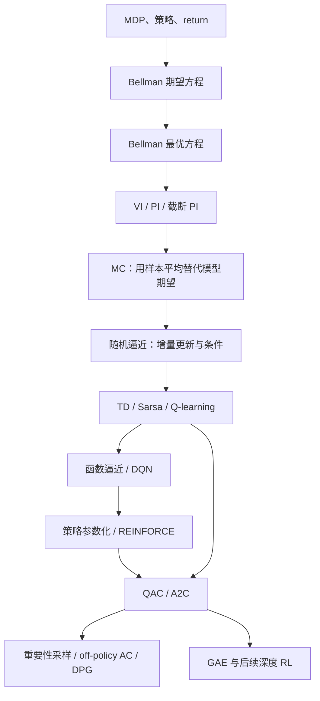

# 《强化学习的数学原理》巩固强化指南

> 适用情况：你已经听完全部网课，希望把“听懂”转化成独立推导、独立实现、独立验证和迁移到深度强化学习的能力。
>
> 本指南依据当前工作区的教材、两套课件、Python/MATLAB 源码、示例图片和 `mynote` 个人笔记编写。逐章任务、时间安排、实验参数和验收门槛是本指南设计的练习，不是教材原有作业或作者承诺的性能。
>
> 建议把本文固定在编辑器一侧，把 [学习进度表](学习进度表.md) 放在另一侧。每次只推进一个任务，完成产物并通过验收后再勾选。

## 目录

1. [最终要掌握到什么程度](#一最终要掌握到什么程度)
2. [仓库资料怎么用](#二仓库资料怎么用)
3. [先读代码：统一环境约定](#三先读代码统一环境约定)
4. [学习节奏、目录与实验规范](#四学习节奏目录与实验规范)
5. [第 0 阶段：诊断与准备](#五第-0-阶段诊断与准备)
6. [第 1—3 周：MDP、Bellman 与动态规划](#六第-13-周mdpbellman-与动态规划)
7. [第 4—6 周：MC、随机逼近与 TD](#七第-46-周mc随机逼近与-td)
8. [第 7—8 周：函数逼近与 DQN](#八第-78-周函数逼近与-dqn)
9. [第 9—11 周：策略梯度与 Actor-Critic](#九第-911-周策略梯度与-actor-critic)
10. [第 12 周：综合项目与结业验收](#十第-12-周综合项目与结业验收)
11. [CS285 的衔接路线](#十一cs285-的衔接路线)
12. [算法对照表与推导清单](#十二算法对照表与推导清单)
13. [排错、复习与产物模板](#十三排错复习与产物模板)
14. [现在就开始的第一轮任务](#十四现在就开始的第一轮任务)

## 一、最终要掌握到什么程度

你的目标是建立下面四层能力。每章都检查这四层，避免只把视频换成阅读 PDF。

| 层次 | 合格表现 | 自我欺骗的常见形式 |
| --- | --- | --- |
| 概念 | 脱离材料，解释问题、假设、输入、输出与适用边界 | 看到术语觉得熟悉 |
| 数学 | 从定义推到更新式，标明期望对谁取、哪些量固定 | 背出公式，却解释不了为什么有 `max` 或梯度 |
| 实现 | 从空白文件写出核心循环，处理终止、探索和数据形状 | 抄完第三方代码能跑 |
| 实验 | 用已知解、反例、多个种子和消融检查结论 | 一条回报曲线上升就认为正确 |

完成主线后，你应当能够：

1. 把一个小任务准确写成 MDP，并解释奖励、终止和折扣如何改变最优策略。
2. 从 return 定义推导 Bellman 方程和 Bellman 最优方程，说明收缩性为什么带来唯一值函数与迭代算法。
3. 独立实现策略评估、VI、PI、截断 PI、MC、TD(0)、Sarsa、Expected Sarsa、n-step Sarsa 和 Q-learning。
4. 用随机逼近解释 TD 更新，区分算法形式、期望更新方向和收敛条件。
5. 区分表格表示、线性函数逼近与神经网络逼近；解释半梯度、投影 Bellman 方程和 DQN 的稳定化措施。
6. 独立实现 REINFORCE、带 baseline 的策略梯度和一个简洁的 A2C；核对梯度符号与数据分布。
7. 解释重要性采样的支持集条件、方差代价及其在 off-policy 学习中的作用。
8. 阅读新算法时，先识别目标函数、采样分布、估计量、优化方式，再判断它相对已有算法改变了什么。
9. 为自己的结论提供可复现的配置、原始数据、图和失败分析。

**能进入 CS285 的信号**：你已经能完成上述核心任务，并能用 NumPy/PyTorch 写清楚一个训练循环。无需在开始后续课程前，把本书每一个测度论证明或所有现代算法都学完。

## 二、仓库资料怎么用

### 2.1 资料清单与优先级

| 仓库内容 | 实际作用 | 本轮使用方式 |
| --- | --- | --- |
| [Readme.md](Readme.md) | 作者说明、课程链接、第三方实现与更新记录 | 起始时读资源定位；实现后再使用第三方链接对照 |
| [目录](<1 - Table of contents.pdf>) | 章节与节号索引 | 按下表定位，减少来回翻找 |
| [全书概览](<2 - Overview of this book.pdf>) | 各章依赖与全书结构 | 开始、结束各读一次，自己重画知识图 |
| [前言](<2 - Preface.pdf>) | 数学深度、读者背景和灰框阅读建议 | 理解教材的取舍，合理安排证明深度 |
| [合订教材](Book-all-in-one.pdf) | 连续阅读、跨章检索 | 作为统一检索入口 |
| 根目录的 10 份分章 PDF | 每章正文、推导、例子与 Q&A | 每周主阅读资料；先闭卷作答，再对照 Q&A |
| [附录](<4 - Appendix.pdf>) | 概率、测度概率、序列收敛、梯度下降 | 按诊断结果回补，具体见第 0 阶段 |
| [Springer 勘误](<5 - Errata for the Springer version.pdf>) | 纸质 Springer 版本勘误 | 重点核查第 2、8、9、10 章及附录 A/D 的公式 |
| [课件说明](<Lecture slides/Readme.md>) | 两套课件的用途说明 | 复习优先使用持续更新版 |
| `Lecture slides/slidesContinuouslyUpdated/` | 更新版 L1—L10，部分含动画展开版本 | 概念回顾和推导辅助；L8 的实际文件名是 `L8-Value function methods.pdf.pdf` |
| `Lecture slides/slidesForMyLectureVideos/` | 录课时使用的 L1—L10 | 仅在需要准确对应已看视频时使用 |
| [网格代码说明](<Code for grid world/README.md>) | 环境说明、依赖与可视化方法 | 与真实源码对照使用，细节以源码和实际探测为准 |
| `Code for grid world/python_version/` | 环境、随机交互示例和绘图 | 整个实践主线的起点 |
| `Code for grid world/matlab_version/` | 环境、固定策略轨迹采样和绘图 | 对照另一种 MDP 约定，作为可选语言路线 |
| Python 的 `plots/` 与 MATLAB 的 JPG/PDF | 策略箭头、轨迹、状态价值的展示样式 | 学习如何表达结果，不能视为算法已收敛的证据 |
| [个人笔记 PDF](mynote/强化学习的数学原理.pdf)、[DOCX](mynote/强化学习的数学原理.docx) | 48 页 PDF，以及大量课件截图和个人标记 | 作为检索入口和错题线索，逐步补成自己的推导与实验结论 |
| `Readme_Images/` | 全书地图、封面、课程与读者反馈图片 | 地图用于梳理依赖；其他图片无需作为学习任务 |
| 已有 `__pycache__/` | Python 字节码缓存 | 不当作源代码学习；例如只有 `utils.cpython-311.pyc`，当前没有对应 `utils.py` 源文件 |

本地仓库没有提供全部算法的完整实现。代码目录说明和根 README 都明确指出：作者有意把算法实现留作练习。根 README 中的第三方项目是外部链接，本指南没有将其视为已经存在于本地、经过验证的实现。

勘误文件注明 GitHub PDF 已经包含这些修正。它主要用于对照纸质 Springer 版和旧笔记，不需要把勘误再机械地应用一次到当前 PDF。

### 2.2 教材章节与周次对应

以下页码指**教材正文印刷页码**，不是 PDF 查看器页序。分章 PDF 通常从章首页开始，合订本还包含前置页，因此用“章号 + 节号”定位最稳妥。

| 周次 | 主要教材 | 优先阅读的节 | 课件 |
| --- | --- | --- | --- |
| 第 1 周 | [第 1 章](<3 - Chapter 1 Basic Concepts.pdf>)，正文 p.1 起 | §1.2—1.7，尤其 §1.3、§1.6 | 更新版 L1 |
| 第 2 周 | [第 2 章](<3 - Chapter 2 State Values and Bellman Equation.pdf>)，p.15 起 | §2.3—2.8 | 更新版 L2，必要时动画版 |
| 第 3 周 | [第 3 章](<3 - Chapter 3 Optimal State Values and Bellman Optimality Equation.pdf>)，p.35 起；[第 4 章](<3 - Chapter 4 Value Iteration and Policy Iteration.pdf>)，p.57 起 | §3.2—3.5；§4.1—4.3 | 更新版 L3、L4 |
| 第 4 周 | [第 5 章](<3 - Chapter 5 Monte Carlo Methods.pdf>)，p.77 起 | §5.1—5.5 | 更新版 L5 |
| 第 5 周 | [第 6 章](<3 - Chapter 6 Stochastic Approximation.pdf>)，p.101 起；第 7 章开头 | §6.1、6.2、6.4；§7.1 | 更新版 L6、L7 |
| 第 6 周 | [第 7 章](<3 - Chapter 7 Temporal-Difference Methods.pdf>)，p.125 起 | §7.2—7.5；Expected Sarsa 可查录课版 L7 | L7 两版按需对照 |
| 第 7 周 | [第 8 章](<3 - Chapter 8 Value Function Methods.pdf>)，p.151 起 | §8.1—8.3，§8.2.5 分层阅读 | 更新版 L8 |
| 第 8 周 | 第 8 章 | §8.4、8.6 | 更新版 L8、录课版 DQN 部分 |
| 第 9 周 | [第 9 章](<3 - Chapter 9 Policy Gradient Methods.pdf>)，p.191 起 | §9.1—9.4，尤其目标与分布的区别 | 更新版 L9 |
| 第 10 周 | [第 10 章](<3 - Chapter 10 Actor-Critic Methods.pdf>)，p.215 起 | §10.1、10.2 | 更新版 L10 |
| 第 11 周 | 第 10 章 | §10.3、10.4 | 更新版 L10 |
| 第 12 周 | 全书与附录 | 跨章闭卷复盘、综合实验 | 自己绘制全书图 |

动画版会把一次推导拆成很多页。页数多不代表新增了同等数量的概念，不需要把两版课件都逐页再看一遍。

### 2.3 把现有个人笔记转化成学习资产

你的笔记已经覆盖了从 MDP 到 DPG 的主线，但较多内容是课件截图。第 28 页的“有点迷”处在随机逼近附近，建议把第 6 章列为重点诊断项，而不是直接判断自己已经会了或不会。

每张重要截图旁边只补四项：

1. **我能独立推到哪一步？** 写出不看截图也能复现的推导。
2. **它在代码里是哪几行？** 指向你自己的实现文件与函数。
3. **它依赖什么条件？** 例如固定策略、覆盖性、终止约定、步长条件。
4. **我怎样验证它？** 写一个手算例子、数值对照或失败反例。

需要特别修正或补充的笔记表述：

- “蒙特卡洛是 on-policy”应改成具体版本的判断：本书主线采用的 MC 控制版本主要是 on-policy，但 MC 也存在借助重要性采样的 off-policy 版本。
- “Q-learning 是 off-policy”需要补上：其目标使用下一状态的贪心动作，行为可由另一探索策略产生；off-policy 不等于必须有 replay buffer。
- `Experience reply` 应为 `experience replay`，即经验回放。
- “现代算法都是在 Actor-Critic 上修修补补”可以作为粗略记忆，正式理解时应分别识别约束优化、熵正则、价值估计偏差和数据分布等设计问题；并非所有相关算法都必须采用同一架构。

## 三、先读代码：统一环境约定

这一步直接影响后续所有实验。**同一个网格图，如果终止或障碍规则不同，就是不同的 MDP；不能拿一个环境的值函数去判另一个环境的实现是否正确。**

### 3.1 Python 代码阅读顺序

依次阅读：

1. [arguments.py](<Code for grid world/python_version/examples/arguments.py>)：默认网格、奖励和动作。
2. [grid_world.py](<Code for grid world/python_version/src/grid_world.py>)：`__init__`、`reset`、`step`、`_get_next_state_and_reward`、`_is_done`。
3. [example_grid_world.py](<Code for grid world/python_version/examples/example_grid_world.py>)：环境怎么调用，为什么它只是随机示例。
4. `grid_world.py` 的 `render`、`add_policy`、`add_state_values`：训练完成后怎样显示结果。
5. MATLAB 的 [main_example.m](<Code for grid world/matlab_version/main_example.m>) 与 [figure_plot.m](<Code for grid world/matlab_version/figure_plot.m>)：做语义对照。

阅读后先回答：状态是什么？动作传入什么类型？奖励在移动前还是移动后确定？到目标是否必须停止？哪些随机数影响真实转移，哪些只影响绘图？

### 3.2 Python 默认配置，逐项核对

| 项目 | 当前源码行为 |
| --- | --- |
| 网格 | 5 列 × 5 行 |
| 坐标 | `(x, y)`，均从 0 开始；`x` 向右增大，`y` 向下增大 |
| 起点 / 目标 | `(2, 2)` / `(4, 4)` |
| 禁区 | `(2, 1)`、`(3, 3)`、`(1, 3)` |
| 动作顺序 | 下、右、上、左、停：`[(0,1),(1,0),(0,-1),(-1,0),(0,0)]` |
| 动作类型 | 原环境 `step` 接收位移 tuple，不是整数动作编号 |
| 奖励 | 目标 `+10`；撞边界或尝试进入禁区 `-5`；普通步 `-1` |
| 进入禁区 | 被挡回原位置，同时得到 `-5` |
| 越界 | 留在边界原位置，同时得到 `-5` |
| 终止标记 | 下一状态等于目标时，`done=True` |
| 到目标以后继续 `step` | 源码允许继续；停留可再次得 `+10`，也能离开目标 |
| `reset()` 返回值 | `(state, info)`，应写 `state, info = env.reset()` |
| `step()` 返回值 | `(next_state, reward, done, info)`，只有四项 |
| 绘图中的轨迹噪声 | `step` 每次产生高斯扰动用于画线，真实 `agent_state` 没有这种噪声 |
| 折扣率 | 环境没有定义，属于算法/实验配置，需要自行指定 |

状态索引建议统一为：

$$
\operatorname{index}(x,y)=yW+x,\qquad
x=\operatorname{index}\bmod W,\quad
y=\lfloor\operatorname{index}/W\rfloor.
$$

其中 `W` 为列数。原可视化也按这个规则放置策略和价值。图上坐标标签、示例打印会加 1，算法内部不要加 1。

原环境 `num_states=25`，但从合法起点出发，3 个禁区不会被进入。建议保留 25 个索引以便绘图，另设合法状态 mask：22 个合法格子，其中 21 个为非终止决策状态。计算学习误差和覆盖率时，明确排除禁区与终止格。

### 3.3 教材、Python 与 MATLAB 的关键差异

| 约定 | 教材第 1 章主例 | Python 默认 | MATLAB 默认 |
| --- | --- | --- | --- |
| 禁区能否进入 | 能进入，但受惩罚，§1.3 明确说明 | 不能进入，回到原位 | 能进入，只施加惩罚 |
| 目标以后 | 按普通状态继续行动，可停留领奖，§1.6 | 报告 `done`，但底层仍允许继续行动 | 采样固定长度轨迹，没有终止判断 |
| 默认尺寸 | 随例子变化 | 5 × 5 | 3 列 × 4 行 |
| 坐标起点 | 图中的状态编号/坐标约定 | 0 | 1 |
| 默认奖励 | 常用目标 `+1`、禁区/边界 `-1`、其他 `0` | `+10 / -5 / -1` | `+1 / -1 / 0` |
| 动作顺序 | 常见上、右、下、左、停 | 下、右、上、左、停 | 上、右、下、左、停 |
| 算法学习 | 教材给推导与伪代码 | 随机动作，没有学习更新 | 固定策略采样，没有 Q-learning 更新 |

MATLAB 图名虽然含 `Q_learning` 或 `Bellman_Equation`，`main_example.m` 当前没有相应算法；其中 `state_value=ones(...)` 也不是求解结果。Python 示例最后的随机策略和 `0—10` 随机值同样只是显示演示。

### 3.4 固定两种实验模式

#### 模式 A：Python 回合任务，作为实现主线

采用 Python 默认参数，指定 `gamma=0.9`，第一次到达目标就结束，目标奖励只在到达的那次转移计入。之后的未来收益为 0。

所有 MC、TD、DQN、REINFORCE 与 A2C 的第一版都用此模式。训练程序处理 `done` 后 `break`，不要直接照抄原示例中被注释的终止判断。

对于模型法，显式把目标设为零奖励吸收态，或者用正确的终止 mask。禁区索引可作为不参与评估的零奖励自环占位。两者都不是修改实际可达部分的任务。

模式 A 的单步目标统一为：

$$
y=r+\gamma(1-\text{terminated})V(s').
$$

控制时把 `V(s')` 换成 Sarsa/Expected Sarsa/Q-learning 对应的下一状态估计。

#### 模式 B：教材式持续任务，用于复现与对照

在自己的实验环境中实现：禁区可进入并受罚、目标为普通状态、停留在目标可重复得到奖励。要复现某幅教材图，还必须同时匹配那一例的尺寸、禁区、奖励、策略与 `gamma`。

不要简单地在 Python 主线中忽略 `done` 就声称完全复现教材；它仍然保留了“禁区不可进入”的不同规则。

**必做对照**：若目标停留每步获得 `+10`，`gamma=0.9`，持续任务下该停留策略的目标价值为 `100`；模式 A 的目标剩余价值为 `0`。两者都可能正确，取决于问题定义。

### 3.5 运行和扩展前的源码注意事项

这些是学习时需要处理的现有实现特点。本指南没有直接修改原始代码。

1. **从 README 指定的目录运行。** `sys.path.append("..")` 使用相对工作目录；初次运行应进入 `python_version/examples/`。
2. **先 `reset` 再交互。** 轨迹数组在 `reset` 中创建。
3. **先初始化画布。** `add_policy` 和 `add_state_values` 使用 `self.ax`，需要先 `render` 一次。
4. **训练循环关闭动画。** 1000 步每步暂停 0.2 秒会耗时至少约 200 秒，不能代表算法计算慢。
5. **不要把任意命令行参数直接传给原脚本。** 其模块在导入时 `parse_args()`，可能吞掉你自己的实验参数或与 notebook 参数冲突。
6. **复杂 CLI 参数当前不适合作为稳定接口。** `type=Union[...]` 不能正常解析用户传入的尺寸字符串，`type=list` 也不能直接解析结构化坐标；初期用独立配置对象/显式构造参数。
7. **奖励不在 `GridWorld` 构造参数中。** 它们从全局 `args` 读取；需要改变时，在自己的适配层中显式设置/管理，而不是误以为构造函数已经接收奖励配置。
8. **配置校验并不完整。** 当前没有充分检查负坐标、维度为正、起点与禁区重叠等；你自己的配置入口应检查这些条件。
9. **固定所有用到的随机源。** 原示例使用 Python `random`；绘图轨迹使用 NumPy 全局 RNG。建议算法独立持有 `np.random.default_rng(seed)`，绘图与动作采样分开。
10. **区分库版本。** 当前接口既不是完整的旧 Gym 接口，也不是 Gymnasium 的五返回值接口；迁移时需要你自己的适配层。
11. **MATLAB 入口文件实际叫 `main_example.m`。** README 提到的 `main.m`、`figure_plot_1.m` 与当前文件名不一致；策略采样还用到 `randsrc`，若本机没有相应工具箱，需要替换为累计概率采样。
12. **图片导出只是展示。** MATLAB 绘图代码有同名 PDF 导出，可能覆盖；要保存实验结果应使用自己的运行目录与文件名。

### 3.6 第一组环境检查与已核对数值

先手算，再调用源码检查。以下坐标都是 0 起始：

| 当前状态 | 动作 | 原 Python 下一状态 | 奖励 | `done` |
| --- | --- | --- | --- | --- |
| `(0,0)` | 上 `(0,-1)` | `(0,0)` | `-5` | False |
| `(2,2)` | 上 `(0,-1)` | `(2,2)`，因 `(2,1)` 是禁区 | `-5` | False |
| `(3,4)` | 右 `(1,0)` | `(4,4)` | `+10` | True |
| `(4,4)` | 停 `(0,0)` | `(4,4)` | `+10` | True |
| `(4,4)` | 左 `(-1,0)` | `(3,4)` | `-1` | False |

最后两行用于理解原环境；模式 A 的训练与评估不会在终止后继续调用动作。

对于模式 A，完整规划模型、均匀随机策略与值迭代的数值检查点为：

- `v_star((2,2)) = 4.58`。
- 均匀随机策略每个动作概率为 `0.2` 时，`v_pi((2,2)) ≈ -18.38412377296025`，这里评估的是不加时间上限的回合目标；`gamma=0.9` 保证有界。
- 进入目标前相邻合法格子的最优价值为 `10`；目标本身的剩余价值为 `0`。
- 起点可用四步到目标，例如右、右、下、下，回报为 `-1 - 0.9 - 0.9² + 10×0.9³ = 4.58`。

这些数值在编写指南时用当前环境转移函数构建模型后核对过。它们适用于本节固定的约定；改变折扣、奖励、障碍或终止后应重新求解。

## 四、学习节奏、目录与实验规范

### 4.1 推荐节奏

默认安排 **12 周主线，每周约 12—16 小时，共约 144—192 小时**。另预留第 0 阶段 3—5 小时做诊断；若数学或 PyTorch 明显薄弱，再增加补基础时间。课表是预算，验收决定是否进入下一阶段。

每周安排五个学习单元，表中的 D1—D5 表示学习单元，不要求恰好是星期一至星期五。可以把一个大单元拆成两天。

| 周次 | 核心问题 | 本周必须留下的产物 |
| --- | --- | --- |
| 1 | 我的环境到底是什么 MDP？ | 环境规范、状态索引、转移检查 |
| 2 | 怎样准确评价固定策略？ | 线性求解器、迭代求解器、Bellman 推导 |
| 3 | 怎样用模型找到最优策略？ | VI/PI/截断 PI、最优解基准 |
| 4 | 没有模型怎样评价与改进策略？ | MC 评估和控制、覆盖率与截断误差报告 |
| 5 | 为什么样本更新能逼近方程的解？ | 均值估计实验、RM 条件分析、TD(0) |
| 6 | 不同 TD 控制算法到底差在哪里？ | Sarsa/Expected/n-step/Q-learning 对照 |
| 7 | 用参数共享代替表格后改变了什么？ | 线性逼近、one-hot 等价验证、投影分析 |
| 8 | DQN 怎样把 Q-learning 变成可训练的神经网络？ | 最小 DQN、梯度检查、两项消融 |
| 9 | 怎样直接优化策略？ | 精确梯度核验、REINFORCE、baseline 对照 |
| 10 | Critic 怎样帮助 Actor？ | QAC 小实验、A2C、优势估计比较 |
| 11 | 怎样利用别的策略的数据？ | IS 实验、off-policy 限制说明、DPG 推导 |
| 12 | 能否独立完成一个可信的 RL 实验？ | 综合项目、闭卷验收、CS285 衔接清单 |

时间不足时，把每周拆成两周执行。不要删去数值基准、终止处理和实验评估来赶进度。

### 4.2 每次学习的固定动作

一个 2—3 小时单元可以按以下顺序执行：

1. 10—15 分钟闭卷回忆：定义、关键式、上次错误。
2. 25—40 分钟定向阅读：只读本次卡住的节和推导。
3. 60—90 分钟推导/实现：关掉参考答案，完成一个可检查任务。
4. 20—30 分钟验证：手算、数值对照、画图、记录失败。
5. 5—10 分钟更新进度：写下下一步的具体入口。

阅读不是禁止项；关键是每次阅读都要解决一个已经明确的问题。整章重复看视频不作为默认复习方式。

### 4.3 建议逐步建立的个人实验目录

下面是**后续由你实现的建议结构**，不是当前已有代码，也不要求第 1 天全部搭好：

```text
practice/
  README.md
  configs/
  envs/
    grid_adapter.py
    textbook_grid.py
  algorithms/
    dp.py
    monte_carlo.py
    stochastic_approximation.py
    td.py
    linear_value.py
    dqn.py
    reinforce.py
    actor_critic.py
  experiments/
  checks/
  notes/
    environment.md
    derivations.md
    mistakes.md
  results/
    run_id/
      config.json
      metrics.csv
      summary.md
      figures/
```

先复用原环境，通过薄适配层提供整数动作、统一状态索引、`terminated/truncated` 和实验配置。模型算法可访问转移模型，model-free 算法的接口只接收采样结果，避免在学习算法中意外读取真值。

不需要一开始写通用 RL 框架、复杂配置系统或大量抽象。一个算法文件能完整读懂，比复杂封装更适合此阶段。

### 4.4 全部实验共用的记录标准

每个实验保存：环境模式、尺寸/障碍/奖励、折扣、起点分布、seed、学习率、探索率、初始化、样本预算、评估方式、依赖版本和原始指标。

比较算法时：

- 横轴优先用**环境交互步数**；补充梯度更新次数和耗时，不能只比较 episode 数。
- 第一轮调试用一个固定种子；形成结论至少用 5 个训练种子，重要结论尽量 10 个。
- 超参数探索与最终比较分开；不要只给一个算法精细调参。
- 记录所有种子的结果；先展示均值和标准差，再补充单种子曲线，不删“难看”的结果。
- 评估时冻结参数，使用独立 RNG。训练探索策略与提取出的贪心策略分别评估并标注。
- 核心比较可从 `1e4、5e4、2e5` 环境步三个预算档开始；不足时先看覆盖和误差，再决定是否增加。
- 对 DQN/PG/AC，小网格的成功不说明已能处理高维图像或连续控制；后续迁移另设任务。

建议统一记录以下指标：

| 指标 | 用途 | 注意 |
| --- | --- | --- |
| 起点折扣回报 `J` | 与训练数学目标对齐 | 与未折扣 episode return 分列 |
| 到达成功率、步数 | 直观任务表现 | 持续任务不能直接照搬回合成功率 |
| `RMSE(V, V_pi)` | 固定策略评估误差 | 不能拿持续变化策略的 V 与旧真值比较 |
| `RMSE(Q, Q_star)` | 控制估计误差 | 仅在统一 MDP、有效状态动作上比较 |
| Bellman 残差 | 模型可用时检查方程 | 小训练 batch loss 不等于小全局残差 |
| `v_star - v_pi` | 用精确求解器评价学到的策略 | 比逐格比较箭头更可靠，因为最优动作可能不唯一 |
| `N(s,a)` 与覆盖率 | 检查探索是否足够 | 固定起点下不可达的状态不应纳入要求 |
| TD error、梯度范数、Q 值范围 | 排错与稳定性 | 作为诊断，不能单独证明策略好 |

### 4.5 终止与截断是贯穿全程的规范

设置训练最大长度，例如 200 步，防止某些初始策略无限徘徊。随后明确你是在处理哪一种问题：

- **真正终止 `terminated=True`**：模式 A 到目标。未来价值为 0。
- **采样时间上限 `truncated=True`**：只是本次采集结束，底层任务仍可继续。TD/DQN 通常保留下一状态 bootstrap；下一次采样需要 reset。
- **任务本身只有 H 步**：有限时域目标。为了保持 Markov 性，状态通常应包含剩余时间，或使用按时间索引的价值函数；不能直接拿无限时域 DP 真值比较。

对 MC，截断后直接把尾部置 0 会引入相对原任务的截断偏差；加上价值估计的尾项后则引入 bootstrap，需明确标注。对于 `|r|≤R_max` 的折扣任务，H 步后忽略尾部的绝对误差上界为：

$$
\frac{R_{\max}\gamma^H}{1-\gamma}.
$$

本指南主线的 `R_max=10`、`gamma=0.9`，H=200 时此上界约 `7.06e-8`，H=20 时约 `12.16`。这是回报尾项的确定性界，不是 MC 总体估计误差。

第 9 周做严格策略梯度核验时，优先使用定义清晰的 H 步目标及其精确递推，与无限时域结果分别报告。

## 五、第 0 阶段：诊断与准备

### 5.1 闭卷诊断，约 60—90 分钟

每题按 0/1/2 分评分：0 为无法说明，1 为能说概念但不能推导或验证，2 为能给出推导、例子或检查方法。总分 24 分仅用于定位，不用于跳过后续实验。

1. 写出 `G_t`、`v_pi(s)`、`q_pi(s,a)` 的定义，说明随机性来自哪里。
2. 不看材料，推导 Bellman 期望方程，解释条件期望的两次展开。
3. 为什么 `gamma<1` 时 `I-gamma P_pi` 可逆？为什么实践中用线性求解而不是显式求逆？
4. 为什么最优值函数唯一，不代表最优策略唯一？举一个并列最优动作的例子。
5. 写出 PI 的两步，以及 MC 怎样替代其中需要模型的步骤。
6. 推导增量样本均值，解释它与常数步长的差异。
7. 写出 TD(0)、Sarsa、Q-learning，明确每个 target。
8. 判断一个算法 on-policy/off-policy 时，要比较哪两个策略？
9. 为什么 TD 函数逼近的常见更新叫半梯度？
10. DQN 的 target network 和 replay 分别改变了什么？
11. 从 `∇pi=pi∇log pi` 说明策略梯度为什么可以采样估计，baseline 为何不改变期望梯度？
12. A2C 的 Actor 与 Critic 各自优化什么？TD error 在什么条件下可估计 advantage？

建议：0—10 分按完整节奏执行并增加基础时间；11—18 分按默认节奏；19—24 分可压缩重复阅读，但保留从空白实现和验收。

### 5.2 数学回补的范围

| 先修能力 | 自测动作 | 参考材料 | 优先级 |
| --- | --- | --- | --- |
| 全概率、条件期望、全期望 | 把 `E[G_t|S_t=s]` 展成对动作与下一状态的求和 | 附录 A，p.237 起 | 必须 |
| 随机变量与样本区分 | 解释 `G_t` 与一次采样 `g_t`，估计量偏差与方差 | 附录 A | 必须 |
| 矩阵、范数、谱半径、线性方程 | 写清 `P_pi` 维度，证明 `||P_pi x||∞≤||x||∞` | 第 2、3 章及线代知识 | 必须 |
| 序列与随机收敛 | 区分几乎必然、依概率、均方收敛 | 附录 C，p.251 起 | 第 5 周前掌握基本区别 |
| 梯度、链式法则、SGD | 手算 softmax 的 log 梯度，说明上升与下降方向 | 附录 D，p.259 起 | 第 7 周前必须 |
| 测度论、条件期望严格定义 | 解释相关概念在随机过程证明中的位置 | 附录 B，p.243 起 | 进阶，不作为本轮第一道门槛 |

### 5.3 环境准备

原项目说明支持 Python 3.7—3.11。为减少环境差异，建议新建 Python 3.11 专用环境，而不是默认使用系统 Python；当前工作区默认 `python` 在检查时是 3.14，且没有 NumPy/Matplotlib。

如果使用 conda，可手动执行以下准备命令；这是建议操作，本指南没有替你安装依赖：

```bash
conda create -n rl-foundations python=3.11
conda activate rl-foundations
python -m pip install numpy matplotlib
```

从仓库根目录启动原示例：

```bash
cd "Code for grid world/python_version/examples"
python example_grid_world.py
```

有桌面环境时可以看动画；无图形界面时设 `MPLBACKEND=Agg` 并保存图片，训练过程不调用 `render`。在受限环境可把 `MPLCONFIGDIR` 指向可写目录。

第 8 周再安装 PyTorch；第 12 周或衔接阶段再安装 Gymnasium 的 classic-control 依赖。具体版本以当时平台和课程要求为准，安装后保存版本列表。

**第 0 阶段产物**：诊断评分、薄弱项清单、一个能导入原环境的 Python 环境，以及第一条环境转移的实际输出。

## 六、第 1—3 周：MDP、Bellman 与动态规划

### 第 1 周：把环境变成可检验的 MDP

**阅读**：第 1 章 §1.2—1.7；更新版 L1；三个 Python 源文件；MATLAB 的转移函数；附录 A 的条件期望。

**本周问题**：我是否能在写任何学习算法前，准确预测每一步会发生什么？

#### 五个学习单元

| 单元 | 具体任务 | 完成标志 |
| --- | --- | --- |
| W01-D1 | 完成代码阅读顺序；画出默认网格；列出状态/动作/奖励/终止规范 | 不看源码能说出第 3 节的全部默认规则 |
| W01-D2 | 实现 `(x,y)↔index`；手算并执行 10 条转移，包括边界、禁区、普通格和目标 | 所有索引往返正确，转移输出符合手算 |
| W01-D3 | 编写自己的薄适配层，提供整数动作和明确的终止/截断信息 | 原环境动作 tuple 与算法整数动作不会混淆 |
| W01-D4 | 构建模式 A 的确定性模型 `P[s,a,s_next]` 与 `R[s,a]` | 21 个有效决策状态的 105 个状态动作转移逐一一致 |
| W01-D5 | 从空白解释 MDP；对比教材/MATLAB；补全环境笔记与检查清单 | 能清楚说明模式 A 与模式 B 的不同 |

#### 推导任务

1. 写出轨迹 `S_0,A_0,R_1,S_1,...`，解释奖励下标为什么是 `R_{t+1}`。
2. 写出 `G_t=R_{t+1}+gamma G_{t+1}`。用一条三步轨迹验证，不要只背递归式。
3. 对随机策略写出 `P_pi(s,s')=sum_a pi(a|s)P(s'|s,a)`。
4. 解释 Markov 性：需要状态包含足以预测未来分布的信息；并不意味着下一状态不依赖当前动作。
5. 给出一个“位置不够作为状态”的例子：剩余时间、钥匙持有情况或动态障碍。

#### 实现要求

模型形状建议为 `P: [25,5,25]`、`R: [25,5]`、`policy: [25,5]`，有效决策状态另用 mask。`R` 是条件期望奖励；确定性环境里就是那次转移奖励。

建模时对终止与禁区占位行采用第 3.4 节约定。检查每个状态动作的转移概率和为 1、每行策略和为 1、有效概率非负。若使用“去掉终止转移”的次随机核，必须另命名并明确其行和可能小于 1。

模型提取可以在这个阶段调用 `_get_next_state_and_reward`，但后续 model-free 训练只能接收采样到的 transition。真值求解器可以保留模型用于离线评分。

#### 验收门槛

- 25 个索引都能往返；所有有效状态动作与真实 `step` 的下一状态、奖励、终止一致。
- 为目标模型设定 `V(target)=0`，没有保留原始“目标停留再得 10”的转移。
- 能解释“禁区一共在网格中占 3 格”与“从合法起点不可进入”不是同一个概念。
- 书面说明：为什么加时间上限后需要区分采样截断与任务终止。

### 第 2 周：建立所有后续实验的固定策略真值

**阅读**：第 2 章 §2.3—2.8；更新版 L2；附录 A 的全期望公式。

**本周问题**：给定策略，我能否用三种独立方式得到一致的价值？

#### 五个学习单元

| 单元 | 具体任务 | 完成标志 |
| --- | --- | --- |
| W02-D1 | 从 return 定义推导 `v_pi` 方程，再推导 `q_pi` 与二者关系 | 每个求和、条件和折扣位置都能解释 |
| W02-D2 | 根据 `P,R,pi` 构造 `P_pi,r_pi`，用线性方程求解 | 均匀策略起点值与 `-18.38412377` 一致 |
| W02-D3 | 实现同步迭代策略评估，保存残差曲线 | 迭代结果与线性解最大误差 `<1e-8` |
| W02-D4 | 冻结同一策略，采样独立回合估计起点回报；比较不同样本量 | 明确采样误差、截断误差与精确真值的区别 |
| W02-D5 | 不看材料重写核心求解；做本章 Q&A；画出价值图 | 公式、代码、数值三个层面一致 |

#### 必须亲自写出的数学链条

$$
v_\pi(s)=\mathbb E_\pi[G_t\mid S_t=s]
=\sum_a\pi(a\mid s)\left[r(s,a)+\gamma\sum_{s'}P(s'\mid s,a)v_\pi(s')\right].
$$

$$
q_\pi(s,a)=r(s,a)+\gamma\sum_{s'}P(s'\mid s,a)v_\pi(s'),
\qquad v_\pi(s)=\sum_a\pi(a\mid s)q_\pi(s,a).
$$

使用上述吸收态模型时可直接写成：

$$
v_\pi=r_\pi+\gamma P_\pi v_\pi,
\qquad (I-\gamma P_\pi)v_\pi=r_\pi.
$$

逐项标注：`P_pi` 是 `[25,25]`，`r_pi,v_pi` 是 `[25]`。公式中可以写逆矩阵，代码使用 `np.linalg.solve`。

#### 必做实验

1. 均匀随机策略：精确求解与迭代求解。
2. 人工确定性策略：让部分状态反复撞墙或原地停留，检查负价值是否符合直觉。
3. `gamma∈{0,0.5,0.9,0.99}`：比较数值范围与迭代速度。`gamma=0` 作为边界检查，值等于期望即时奖励。
4. 同步更新与原地更新：比较运行过程，说明它们不必在每轮产生相同数组；主验收使用同步版本。

#### 验收门槛

- 精确解的 Bellman 残差 `<1e-10`，迭代解对精确解的最大误差 `<1e-8`，使用双精度小网格。
- 能解释样本平均为什么不会严格等于真值，以及为什么不能只抽一条轨迹。
- 能从 `q_pi` 还原 `v_pi`，并逐状态核对。
- 回答：Bellman 方程中的 `pi` 是固定输入，未知量是价值；方程本身还没有完成最优策略搜索。

### 第 3 周：最优方程、VI、PI 与截断 PI

**阅读**：第 3 章 §3.2—3.5；第 4 章 §4.1—4.3；更新版 L3、L4。

**本周问题**：为什么“反复备份”能给出最优价值，三种规划算法之间有什么联系？

#### 五个学习单元

| 单元 | 具体任务 | 完成标志 |
| --- | --- | --- |
| W03-D1 | 写出 Bellman 最优算子，完成无穷范数下收缩性的证明 | 明确假设 `gamma<1` 和逐状态 `max` |
| W03-D2 | 实现同步 VI，提取贪心策略，保存值与残差 | 默认模式 A 起点最优值 `4.58` |
| W03-D3 | 用第 2 周精确评估器实现 PI，处理并列最优动作 | 每次策略改进后精确价值不下降 |
| W03-D4 | 实现截断 PI，比较评估步数 `m=1,3,10` 与充分评估 | 分别记录备份次数、策略轮数和耗时 |
| W03-D5 | 改变奖励与折扣，解释策略变化；整理 DP 基准文件 | VI 与 PI 价值一致，保留最优解供后续评分 |

#### 必须掌握的证明

先证明：

$$
|\max_a x_a-\max_a y_a|\leq\max_a|x_a-y_a|.
$$

再定义 `T_star` 并得到：

$$
\|T_*u-T_*v\|_\infty\leq\gamma\|u-v\|_\infty.
$$

最后说明：完备空间上的收缩映射有唯一不动点，迭代收敛到该点；但多个动作可能同时达到最大值，所以最优策略不必唯一。

对任意候选 `v`，若 `epsilon=||T_star v-v||∞`，则：

$$
\|v-v_*\|_\infty\leq\frac{\epsilon}{1-\gamma}.
$$

用这个界设计停止条件。注意停止差分属于哪两个迭代数组，避免以一个数组的残差声称另一个数组具有同样精度。

#### 实现细节

- PI 的初版直接用线性方程进行策略评估，减少嵌套近似误差。
- 若出现并列最优动作，可固定最小编号，或优先保留原动作；明确容差，避免策略在等价动作间来回切换。
- 比较最优性时优先比较 `v` 和精确 `v_pi`，不要要求箭头逐格完全相同。
- 截断 PI 要说明顺序：本轮策略、初始价值、m 次评估和改进分别在何时执行；复用上一轮价值时，m=1 与 VI 的关系取决于相同的初始化和编号约定。

#### 验收门槛

- VI 与 PI 的有效状态价值最大差 `<1e-8`。
- 默认起点最优值为 `4.58`，相邻目标格价值为 `10`，目标为 `0`。
- 至少两种最优路径并存时，不会把策略不同误判为实现错误。
- 用自己的语言说明 PI→MC、Bellman 期望方程→TD、Bellman 最优方程→Q-learning 的后续关系。

**阶段一结束产物**：规范一致的环境、固定策略精确评估器、最优值/动作值基准和三种规划算法。后面每一章都使用它们核验。

## 七、第 4—6 周：MC、随机逼近与 TD

### 第 4 周：Monte Carlo，把模型期望换成经验平均

**阅读**：第 5 章 §5.1—5.5；更新版 L5；回看 PI 的评估—改进结构。

**本周问题**：没有转移概率，我怎样用采样得到价值，又怎样保证探索足够？

#### 五个学习单元

| 单元 | 具体任务 | 完成标志 |
| --- | --- | --- |
| W04-D1 | 固定均匀策略，保存完整回合；从后向前计算所有 return | 手算轨迹与程序输出逐项相同 |
| W04-D2 | 实现 first-visit 与 every-visit MC 评估，核对访问计数 | 误差对固定策略精确解作图，未访问状态不伪装成已估计 |
| W04-D3 | 实现小规模 MC Basic 和 MC Exploring Starts | 说明任意起始状态动作的采样接口与覆盖条件 |
| W04-D4 | 实现 MC epsilon-greedy 控制，比较不同 epsilon | 保存训练策略与提取贪心策略的分别评估结果 |
| W04-D5 | 比较样本效率、覆盖和截断误差；做 Q&A | 能解释为何固定 epsilon 时不能要求探索策略等于最优确定性策略 |

#### 从 PI 到 MC 的推导

先写：

$$
q_\pi(s,a)=\mathbb E_\pi[G_t\mid S_t=s,A_t=a].
$$

然后把期望替换成同一策略下的样本均值：

$$
\hat q(s,a)=\frac{1}{N(s,a)}\sum_{i=1}^{N(s,a)}G^{(i)}(s,a).
$$

解释：这里不需要显式 `P`，但需要足够覆盖的经验；“model-free”不等于“不需要环境或数据”。

#### 实现顺序与细节

1. 先写 `compute_returns(rewards, gamma)`，最后一项从 0 开始反向递推。
2. 再做**固定策略**评估，确认估计能力；此时不要一边更新策略一边把结果与旧策略真值比较。
3. 再做动作价值估计和控制。
4. MC Basic 在小网格上为每个有效 `(s,a)` 重新采样若干回合，体验其开销即可，不必用它训练巨量预算。
5. Exploring Starts 需要你自己的 `reset_to(state)` 或等价接口。原 `reset` 不接收任意起点；把起点参数管理清楚，并且排除禁区与终止格。
6. First-visit 的“first”指轨迹正向时间中的第一次。倒序遍历时遇到就加入 `seen` 的简单写法通常得到的是 last-visit，需提前确定首次索引或检查前缀。
7. 控制策略在一次回合采集期间保持固定；在 episode 结束后再更新，便于清楚解释数据来自哪个策略。

手算练习：在 `(3,4)` 先停、再停、再右移到目标，奖励为 `[-1,-1,10]`。取 `gamma=0.5`，各时刻 return 为 `[1,4,10]`。对重复出现的 `((3,4), 停)`，first-visit 使用 `1`，every-visit 使用 `1` 和 `4`，这一回合内均值为 `2.5`。这不是两个估计器必须每回合相等的理由。

#### 探索策略必须写清楚

若当前并列贪心动作集合为 `G(s)`，动作总数为 A，采用均匀探索与均分并列最大值时：

$$
\pi(a\mid s)=\frac{\epsilon}{A}
+\mathbf 1[a\in G(s)]\frac{1-\epsilon}{|G(s)|}.
$$

检查概率和，不要把“以 epsilon 概率随机选全部动作”错写成“只在非贪心动作里随机”。两种定义都能构造，但必须与公式一致。

#### 必做实验

- 固定策略：独立回合数 `100、1000、10000`，至少 5 个种子；比较起点估计误差和全有效状态的访问覆盖。
- First-visit 对 every-visit：使用同一批冻结的回合，比较估计误差、更新样本数与跨种子方差。不要声称回合内每次访问互相独立。
- MC 控制：`epsilon∈{0,0.05,0.1,0.3}`，相同环境步预算；统计未访问状态动作数。
- 截断：比较 H=20、50、200，对照第 4.5 节尾项界。
- 可选：从多个合法起点采样，比较其与固定起点的覆盖差异，并明确训练分布改变了。

#### 验收门槛

- Return、first/every-visit 和 `N(s,a)` 通过手算例子。
- 对固定策略，多种子汇总显示增加样本通常降低估计误差；不要求每个种子的每个采样点单调下降。
- 给出 MC Basic→ES→epsilon-greedy 的改进点：回合复用、策略改进频率、探索方式。
- 说明固定 epsilon、探索覆盖、截断和步数不足为什么都会造成与 `Q_star` 的差异。

### 第 5 周：随机逼近与 TD(0)，把最薄弱的桥补牢

**阅读**：第 6 章 §6.1、6.2、6.4；第 7 章 §7.1；附录 C。§6.3 的 Dvoretzky 定理先看结论和用途，完整证明作为进阶。

**本周问题**：一个带噪声的更新，为什么能不断靠近某个方程的解？

#### 五个学习单元

| 单元 | 具体任务 | 完成标志 |
| --- | --- | --- |
| W05-D1 | 从样本平均推导增量形式，比较样本均值和常数步长 | 两种算法的作用和适用情形都能说明 |
| W05-D2 | 做一维带噪求根实验，逐项分析 Robbins–Monro 条件 | 解释满足步长条件为何仍不等于无条件收敛 |
| W05-D3 | 手写简单线性回归的 GD/SGD/mini-batch GD | 从目标函数推导到随机梯度，而非调用优化器黑盒 |
| W05-D4 | 从 Bellman 期望方程构造 TD(0)，冻结均匀策略训练 | 正确处理终止，对精确 `v_pi` 计算误差 |
| W05-D5 | 对比 MC 与 TD；重写笔记中“有点迷”的部分 | 一页讲清“方程—期望更新—样本更新—条件” |

#### 第一条推导：增量均值

$$
\bar x_n=\bar x_{n-1}+\frac{1}{n}(x_n-\bar x_{n-1}).
$$

把 `1/n` 改成常数 alpha 后，更新成为指数加权估计，不再等于全部历史样本的普通平均。它能跟踪变化，但一般保留稳态波动。

实验使用你自己生成的、均值已知的随机样本。先用静态均值，再在一半时把真实均值改变，比较 `alpha_n=1/n` 与常数步长的适应速度。

#### 第二条推导：带噪求根

考虑 `h(w)=w-mu`，只观察到带噪的 `w-X_n`：

$$
w_{n+1}=w_n-\alpha_n(w_n-X_n).
$$

说明它既是求根，又与最小化均方误差有关。经典步长条件：

$$
\sum_n\alpha_n=\infty,\qquad
\sum_n\alpha_n^2<\infty.
$$

逐个判断：`1/n`、`1/n^0.6`、`1/sqrt(n)`、`1/n^1.2`、常数。前两个满足上述两项，其他分别违背平方可和、步长和发散或平方可和条件。还需要检查均值方向、稳定性、噪声矩等假设。

#### 第三条推导：从方程到 TD

固定 pi，令：

$$
\delta_t=R_{t+1}+\gamma(1-\mathrm{terminated}_t)V(S_{t+1})-V(S_t),
$$

$$
V(S_t)\leftarrow V(S_t)+\alpha_t(S_t)\delta_t.
$$

在当前 V 固定、按相应策略采样转移的条件下：

$$
\mathbb E[\delta_t\mid S_t=s]=(T_\pi V)(s)-V(s).
$$

也就是说，TD 误差提供 Bellman 残差方向的随机样本。它的 bootstrap 目标通常不是 `v_pi(s)` 的无偏观测，不能把“条件期望等于算子更新”误写成“当前 TD target 对真值总无偏”。

本指南统一采用 **target 减 current** 的 delta。教材或笔记某些地方采用相反符号，并在更新时减去该误差。两者可等价，代码不能把定义和更新的符号混用。

#### 步长和理论的边界

- 表格更新要考虑每个被更新状态/状态动作自己的访问次数，不是只看全局时间。
- `alpha=1/N(s)` 可作为诊断性选择，不能仅凭这一项声称所有设置都满足收敛定理。
- 轨迹样本存在时间相关性；RL 中常涉及 Markov 噪声及相应覆盖条件，不能直接把所有数据当 iid。
- 常数学习率实验中持续波动是预期现象之一；不能据此否定递减步长下的理论结论。

#### 必做实验与验收

1. 均值估计：全量均值与增量 `1/n` 结果达到浮点误差范围的一致。
2. 步长实验：展示一种步长衰减过快、总移动量不足的例子。
3. TD(0)：先用手工一步更新核对，再跑冻结策略；与第 2 周真值比较。
4. MC 对 TD：使用相同策略、相同交互预算与至少 5 个种子，讨论方差、bootstrap 偏差、在线性和每次更新成本。
5. 闭卷写出“Bellman 方程不是样本更新式，但其残差可以被随机近似”的完整解释。

**不通过则回补**：如果只能记住 `V += alpha*delta`，却不能写出 delta 的条件期望，本周不要直接进入 DQN。

### 第 6 周：TD 控制，把 target 的差异看透

**阅读**：第 7 章 §7.2—7.5；录课版 L7 的 Expected Sarsa 部分；本章 Q&A。

**本周问题**：行为策略、目标策略和 bootstrap target 分别是什么？

#### 五个学习单元

| 单元 | 具体任务 | 完成标志 |
| --- | --- | --- |
| W06-D1 | 实现 Sarsa，手工核验连续两个动作的选择顺序 | `a_next` 由当前行为策略采样，终止时不强行采样 |
| W06-D2 | 实现 Expected Sarsa，用解析求和核对其 target | 下一状态策略概率与 Q 值内积正确 |
| W06-D3 | 实现 Q-learning，分别标注 beta 与贪心目标策略 | max 是在动作轴上取，不是跨整个 Q 表 |
| W06-D4 | 实现 n-step Sarsa，测试 n=1 与越过终止的情况 | n=1 退化为 Sarsa，终止后不 bootstrap |
| W06-D5 | 做统一预算对照与固定数据实验，整理算法差异表 | 能用一条 transition 解释四种 target 的不同 |

#### 四个单步 target

令 `m=1-terminated`：

$$
\begin{aligned}
y_{\mathrm{Sarsa}} &= r+\gamma m Q(s',a'),\quad a'\sim\pi(\cdot\mid s'),\\
y_{\mathrm{Expected}} &= r+\gamma m\sum_{a'}\pi(a'\mid s')Q(s',a'),\\
y_{\mathrm{Q}} &= r+\gamma m\max_{a'}Q(s',a'),\\
Q(s,a)&\leftarrow Q(s,a)+\alpha[y-Q(s,a)].
\end{aligned}
$$

把代码中唯一改变的 target 画出来，同时说明：采样方式和被评价/优化的策略可能也不同，不能只把它们当成随意互换的公式。

Expected Sarsa 可以有 on-policy 或 off-policy 设置，取决于 target 中的 pi 与行为 beta 是否相同。本周先实现 on-policy 版本。

#### n-step 边界处理

在没有提前终止的情况下：

$$
G_t^{(n)}=\sum_{k=0}^{n-1}\gamma^kR_{t+k+1}
+\gamma^n Q(S_{t+n},A_{t+n}).
$$

若在 t+n 前到达终止时刻 T，只累计到 `R_T`，并去掉 bootstrap。轨迹采完后，需要把末尾尚未更新的状态动作“冲刷”完成。

测试三种情形：n=1、n 小于剩余长度、n 大于剩余长度。大 n 与 MC 的关系依赖同样的回合和策略约定，不要把所有在线控制设置下的数值完全相等作为要求。

#### 必做实验

1. 相同网格、相同总交互预算比较 Sarsa、Expected Sarsa、Q-learning，至少 5 个种子。
2. 同时评价训练 epsilon 策略和提取的贪心策略；固定 epsilon 的 Sarsa 主要评价其探索策略，不能只拿它的 Q 与 `Q_star` 比较。
3. `n∈{1,3,5,10}`：比较同预算下的回报与波动，并分析 bootstrap 距离。
4. 冻结一批由均匀行为 beta 产生的数据，循环训练 Q-learning；检查覆盖。说明这里是固定数据学习实验，不能自动等同于完整的现代 offline RL 方法。
5. 可选：建立一个“可进入危险区但受罚”的小环境，研究探索风险。原 Python 禁区是墙，不能直接将其曲线解释成标准 cliff-walking 结论。

#### 验收门槛

- 手算 transition 得到的 target 与程序完全一致；终止 transition 的 target 都为即时奖励。
- 对同一组 Q 值，Expected Sarsa 计算的是目标策略加权均值，Q-learning 计算最大值。
- 检查每个有效状态动作的访问数，未覆盖项不能用“训练已经足够”掩盖。
- 在合理预算与调参后，至少能稳定学出起点四步到目标的贪心策略；若达不到，必须先定位覆盖、步长、终止或索引问题。
- 若某算法失败，保留失败种子并给出诊断；不把“所有算法都应在固定步数达到同一阈值”当作理论保证。

**阶段二结束产物**：你能用“精确期望→样本平均→带噪增量更新”的主线，解释 DP、MC 与 TD 的联系，并为每种算法给出正确 target。

## 八、第 7—8 周：函数逼近与 DQN

### 第 7 周：从表格到线性函数，先分离表示误差与学习误差

**阅读**：第 8 章 §8.1—8.3；§8.2.5 的线性 TD 与投影分析；附录 D。

**本周问题**：参数共享带来泛化，也引入什么额外误差和稳定性问题？

#### 五个学习单元

| 单元 | 具体任务 | 完成标志 |
| --- | --- | --- |
| W07-D1 | 用 DP 真值做监督拟合，比较 one-hot 与坐标多项式特征 | 先知道函数本身能否表示真值 |
| W07-D2 | 推导并实现线性 MC 与半梯度 TD 评估 | 正确区分监督真值 target 与 bootstrap target |
| W07-D3 | 用 one-hot 核验线性 TD 与表格 TD 的等价性 | 同一轨迹、同一步长、同一初值逐次更新一致 |
| W07-D4 | 用低维特征比较最小二乘解与 TD 固定点 | 解释两者一般不同，并写出投影方程 |
| W07-D5 | 扩展到线性 Sarsa/Q-learning；讨论分布与稳定性 | 一页说明 deadly triad 与理论适用范围 |

#### 必须写清的对象与形状

$$
\hat v(s;w)=\phi(s)^\top w,\qquad
\Phi\in\mathbb R^{n\times d},\quad w\in\mathbb R^d.
$$

优先比较：

1. One-hot：为有效状态提供独立参数，可重现表格法。
2. 归一化坐标：`[1,x,y]`。
3. 二阶特征：`[1,x,y,x²,xy,y²]`。
4. 可选 RBF/分块特征：用于观察表达能力和局部性。

坐标先归一化。不要把任意状态编号直接当作连续数值特征，而不说明这会人为引入怎样的相似性。

#### 三个不同问题，必须分开

**问题一：已知真值的监督拟合。**

$$
\min_w\sum_s d(s)[v_\pi(s)-\phi(s)^\top w]^2.
$$

用 `lstsq` 或相应加权最小二乘做参考，先测量表示限制。低维特征拟合不了障碍附近的复杂价值面，是有意义的结果。

**问题二：使用 MC return 的学习。** Return 是固定策略价值的采样目标，但有方差和可能的截断误差。

**问题三：使用 bootstrap 的半梯度 TD。**

$$
w\leftarrow w+\alpha\delta_t\phi(S_t).
$$

这里把 target 在本次更新中当常量，没有对下一状态价值中的同一组参数继续求导，因此称为半梯度。一般不能说它就是在直接对真实 MSVE 做 SGD，也不能说普通半梯度 TD 总是在直接对 MSPBE 做梯度下降。

#### 投影分析的合格深度

令 `D=diag(d)`，理想化 on-policy 稳态采样、线性特征及相应满秩条件下：

$$
A=\Phi^\top D(I-\gamma P_\pi)\Phi,\qquad
b=\Phi^\top Dr_\pi,\qquad Aw=b.
$$

相应固定点满足：

$$
\Phi w=\Pi_D T_\pi(\Phi w).
$$

你应当解释为什么“把真值投影到特征空间”和“投影 Bellman 固定点”通常不是同一件事，以及误差中哪些来自表示、采样、优化或 bootstrap。

为了与教材的稳态假设对齐，这部分推导/数值核验优先放在模式 B 的固定、充分探索策略下；直接把模式 A 的吸收链稳态分布拿来，会使概率最终集中到目标，无法代表回合采样的非终止占用分布。若仍使用模式 A，需要显式处理 reset 后的采样过程或回合占用权重。

LSTD 可作为进阶：直接估计 A 和 b，再求解参数。先理解目标与固定点，不必把其实现作为进入第 8 周的硬条件。

#### 必做实验与验收

- One-hot 等价实验：同一条轨迹每次更新的最大差 `<1e-10`，使用 float64。
- 真值监督拟合对 TD：报告各自的权重、MSVE 和采样分布，而不是只看最终曲线。
- 在不同特征与访问分布下报告误差，说明“经常访问的状态更准”与目标加权有关。
- 解释 deadly triad：函数逼近、bootstrap、off-policy 三者组合可能产生不稳定；它是风险结构，不表示每个相关实验必然发散。
- 能区分“表格 Q-learning 的特定收敛条件”与“神经网络 Q-learning 在任意设置下收敛”，后者没有这样的通用保证。

### 第 8 周：最小 DQN，理解训练管线中的每个部件

**阅读**：第 8 章 §8.4、8.6；更新版 L8 与录课版 L8 的 DQN 部分。

**本周问题**：从 Q-learning 到 DQN，网络、数据和目标分别发生了什么变化？

#### 五个学习单元

| 单元 | 具体任务 | 完成标志 |
| --- | --- | --- |
| W08-D1 | 补 PyTorch：张量、batch、autograd、optimizer；用 DP 真值监督拟合 Q 网络 | 输入输出 shape 与动作 gather 正确 |
| W08-D2 | 实现 replay buffer，保存终止与截断，核对采样结果 | buffer 不泄漏真值，采样单位是一条完整 transition |
| W08-D3 | 加入 online/target network，实现最小 DQN | target 无梯度，终止 target 正确，目标网络确实同步 |
| W08-D4 | 检查固定 batch 训练，再做端到端训练 | loss、梯度、Q 范围与回报都能诊断 |
| W08-D5 | 完成无 target、无 replay 两项单因素消融 | 保存所有种子，避免把小任务偶然成功当作普遍结论 |

#### 最小实现范围

网络先使用归一化 `(x,y)` 输入、两层小 MLP、输出 5 个动作的 Q 值；one-hot 输入作为诊断备选。它与教材可能采用的 `(s,a)` 联合输入是两种等价的 Q 函数接口选择，形状和采样方式需要对应。

第一版只包含：

- epsilon-greedy 数据采集。
- 固定容量 replay buffer。
- 按 transition 均匀抽样的 minibatch。
- online/target 两张初始一致的网络。
- 固定频率 hard update。
- MSE 或明确标注的 Huber loss。
- 终止 mask、独立评估与日志。

暂不叠加 Double、Dueling、PER、多步回报等改进，先建立可解释基线。

#### 核心目标与形状

$$
y_i=r_i+\gamma(1-\mathrm{terminated}_i)
\max_{a'}Q_{\bar w}(s'_i,a'),
$$

$$
L(w)=\frac{1}{B}\sum_i\left(Q_w(s_i,a_i)-\operatorname{stopgrad}(y_i)\right)^2.
$$

检查：状态 `[B,2]`；网络输出 `[B,5]`；动作 `[B]`；选中动作的预测、奖励、mask 与 target 最终统一成 `[B]`。一个 `[B,1]` 与一个 `[B]` 相减可能意外广播成 `[B,B]`。

使用向量 Q 网络时，`max` 在动作维；训练只回归已执行动作的 Q 值。target network 的参数不由当前 loss 优化，也不通过 `y` 接收梯度。

#### 初始参数建议

这些仅用于小网格的起步实验，不是保证收敛的最优配置：

| 参数 | 起始值 | 检查重点 |
| --- | --- | --- |
| `gamma` | 0.9 | 与 DP 真值保持一致 |
| 隐层 | 64、64，ReLU | 先证明能监督拟合 Q 真值 |
| batch | 64 | 是否有意外广播 |
| replay 容量 | 10000 | 记录实际填充与访问覆盖 |
| 开始更新前采集 | 1000 步 | 过早只训练极少样本会偏狭 |
| Adam 学习率 | `1e-3`，必要时试 `3e-4` | 按小范围预先说明的候选比较 |
| hard update | 每 200 次梯度更新 | 日志明确单位不是 episode |
| 更新频率 | 每环境步一次更新 | 同时记录交互和更新次数 |
| epsilon | 从 1.0 降到 0.05，约前 20000 步 | 先看覆盖，不盲目加快衰减 |
| 预算 | 先 50000 环境步 | 失败先排错，再提高预算 |

#### 经验回放的一个重要辨析

教材/课件使用均匀回放的教学设定。实现时必须区分：**从 buffer 中均匀抽记录，不等于对所有状态动作对均匀抽样**；频繁出现的 `(s,a)` 在 buffer 中仍然占更多记录。

Replay 能复用经验并改变训练样本的时间相关结构和经验分布，但不能自动解决覆盖不足、所有分布偏移或 off-policy 不稳定。优先回放等方法是后续扩展，不能因为本章使用均匀抽样就认为其他抽样永远不允许。

#### 消融与验收

1. 完整最小 DQN 为基线。
2. 只去掉 target network：以当前 online 网络生成 target，但仍按同样规则停止 target 梯度。
3. 只去掉 replay：使用当前/近期在线样本，清楚记录训练数据和更新次数如何变化；若不能完全匹配 batch 结构，报告该限制。
4. 比较回报、方差、`Q_star` 误差、目标漂移与梯度范数。

验收时至少满足：

- 固定 batch 的 selected-action loss 可以明显下降，梯度传递正常。
- target 网络在指定同步前参数保持不变，同步后与 online 对齐。
- 终止 transition 的 target 恰为奖励；采样截断保留相应 bootstrap。
- 能训练出有竞争力的策略，并与同一 MDP 下的表格 Q-learning 和 DP 上界比较。
- 如果三种设置都能解小网格，结论是此任务不足以证明稳定化部件的必要性，不能编造“去掉必然发散”的结论。

**阶段三结束产物**：你理解值函数学习的表示、目标、采样和优化四个部分，并完成一个能逐项排错的 DQN。

## 九、第 9—11 周：策略梯度与 Actor-Critic

### 第 9 周：REINFORCE，先把目标和梯度核对清楚

**阅读**：第 9 章 §9.1—9.4；尤其 §9.2 的不同指标、§9.3.1 的分布，以及 §9.4 的采样讨论。

**本周问题**：我究竟在优化哪个标量，收集到的数据是否能估计它的梯度？

#### 五个学习单元

| 单元 | 具体任务 | 完成标志 |
| --- | --- | --- |
| W09-D1 | 写出 softmax 策略及 log 梯度；比较初始分布价值和稳态平均奖励 | 不再把所有 J 都混成一种指标 |
| W09-D2 | 在小 MDP 上计算精确目标、精确梯度与中心差分 | 梯度符号、折扣与占用权重核验通过 |
| W09-D3 | 实现 tabular-softmax REINFORCE，按 batch 冻结策略收集回合 | loss 的梯度是目标梯度的负估计 |
| W09-D4 | 加入 state baseline；比较固定策略下的梯度估计方差 | 说明无偏性条件及方差变化，而非只看训练回报 |
| W09-D5 | 转成小神经策略，做至少 5 种子训练 | 留下目标说明、梯度检查与训练结果 |

#### 第一步：区分教材中的三个指标

$$
J_{d_0}(\theta)=\sum_s d_0(s)v_{\pi_\theta}(s),
$$

$$
\bar v_\pi(\theta)=\sum_s d_\pi(s)v_{\pi_\theta}(s),\qquad
\bar r_\pi(\theta)=\sum_s d_\pi(s)r_{\pi_\theta}(s).
$$

固定起点/初始分布 `d_0` 与依赖 theta 的稳态分布 `d_pi` 不同。对于平均奖励的无折扣分析，还需要相应的差分价值等定义，不能简单在无限回报和中令 `gamma=1`。

对每个指标写下：状态权重是否依赖 theta？梯度公式是严格等式还是某种近似？对应采样分布是什么？是否需要遍历/稳态等条件？

本轮实现主线采用模式 A 的固定起点折扣目标；为做严格数值检查，再定义清楚 H 步截断目标。教材的稳态推导作为第二条理解线，不能直接套用吸收任务最终集中在目标的稳态分布。

#### 第二步：从轨迹概率推导

在环境动力学不依赖 theta、初始分布固定的条件下：

$$
p_\theta(\tau)=d_0(s_0)\prod_t\pi_\theta(a_t\mid s_t)P(s_{t+1}\mid s_t,a_t),
$$

$$
\nabla_\theta\log p_\theta(\tau)
=\sum_t\nabla_\theta\log\pi_\theta(a_t\mid s_t).
$$

先从完整轨迹回报的 likelihood-ratio 形式开始，再解释为什么过去奖励与当前 score 的期望贡献为 0，从而可以使用 reward-to-go。

若定义：

$$
J_H(\theta)=\mathbb E\left[\sum_{t=0}^{H-1}\gamma^t R_{t+1}\right],\qquad
G_t=\sum_{k=t}^{H-1}\gamma^{k-t}R_{k+1},
$$

则对应梯度为：

$$
\nabla_\theta J_H
=\mathbb E\left[\sum_{t=0}^{H-1}\gamma^t
\nabla_\theta\log\pi_\theta(A_t\mid S_t)G_t\right].
$$

这里的外层 `gamma^t` 与 `G_t` 内部的折扣承担不同角色。部分实现省略外层折扣，是采用了不同采样权重或实用近似；做精确核验时必须与自己的目标一致。

#### 第三步：用小 MDP 核验梯度

使用模式 A 或更小的两三个决策状态 MDP，先采用 tabular logits 和 float64，不急着上神经网络。

1. 固定 H，例如 H=20；目标结束后按零奖励吸收状态延长到 H。
2. 用向后动态规划精确计算时间相关的 `v_t(s)` 和 `q_t(s,a)`。
3. 用向前递推计算 `p_t(s)=Pr(S_t=s)`。
4. 按 `sum_t gamma^t sum_s p_t(s) sum_a pi(a|s) grad_log_pi(a|s) q_t(s,a)` 得到精确梯度。
5. 重新求解扰动参数下的目标，计算中心差分：

$$
g_j^{FD}=\frac{J_H(\theta+he_j)-J_H(\theta-he_j)}{2h}.
$$

6. 先试 `h=1e-5`，再试邻近尺度，检查是否存在稳定误差区间；抽查若干参数或随机方向即可。
7. 冻结 theta，采集多批独立回合，比较 MC 梯度均值与精确梯度。

精确枚举/递推对中心差分可要求归一化误差 `<1e-5`，分母用 `max(1,||g_FD||)` 避免接近零时失真。MC 部分报告误差随 batch 数变化及标准误，不要求随机估计也达到同等精度。

Tabular softmax 有：

$$
\frac{\partial\log\pi(a\mid s)}{\partial\theta_{s,b}}
=\mathbf 1[a=b]-\pi(b\mid s).
$$

同一状态所有 logits 平移相同常数不改变策略。可以用“梯度对该状态 logits 求和为 0”作为额外检查。

#### 第四步：REINFORCE 的训练约定

对 B 条在同一个 `theta_k` 下生成的回合，先计算 return，再优化：

$$
L_{actor}=-\frac{1}{B}\sum_{i=1}^B\sum_t
\gamma^t\log\pi_\theta(a_{i,t}\mid s_{i,t})
\operatorname{stopgrad}(G_{i,t}-b(s_{i,t})).
$$

严格的初版按“每回合求和、对回合平均”。随机长度下按总 transition 数归一化会改变 batch 权重，先不要在梯度核验中混用。

要点：

- 采样一批数据时保持策略固定，完成本批计算后再更新。
- 不要沿着一条旧回合边更新 theta、边把所有动作当作新策略的 on-policy 数据。
- 使用稳定的 `log_softmax` 或 `Categorical(logits=...)`，不要手动对极小概率直接取 log。
- 训练是随机策略，评估时分别报告“继续随机采样”和“argmax 动作”的结果。
- 第一版先关掉 entropy bonus 和 advantage normalization，等严格梯度核验通过后再把它们作为明确的扩展。

#### Baseline 实验必须怎么做

先证明：

$$
\mathbb E_{A\sim\pi(\cdot\mid s)}[
\nabla\log\pi(A\mid s)b(s)]
=b(s)\nabla\sum_a\pi(a\mid s)=0.
$$

这里 baseline 对动作不能有依赖，且 Actor 求梯度时不穿过它。H 步有限时域的精确 baseline 可以是 `v_t(s)`，因为时间也是状态信息的一部分。

固定同一个策略，反复采样，比较 baseline=0、常数 baseline、精确 `v_t(s)` 和由前一批数据拟合的 baseline。记录梯度样本均值及协方差迹/各分量方差。任意 baseline 不保证降低方差，`v_pi` 也不是所有参数化下严格的最优方差 baseline。

#### 验收门槛

- 能闭卷完成 log-derivative trick、reward-to-go 和 baseline 不变性的推导。
- 精确梯度与中心差分相符；MC 梯度没有方向性错误。
- 解释外层折扣、回合平均、数据冻结及 `detach` 的作用。
- 训练结果有多个种子，和 DP 上界比较；不用一次成功掩盖高方差。

### 第 10 周：QAC 与 A2C，让 Critic 进入训练循环

**阅读**：第 10 章 §10.1、10.2；回看第 7 章 TD 与第 9 章目标分布。

**本周问题**：Critic 提供什么信息，它的误差如何影响 Actor？

#### 五个学习单元

| 单元 | 具体任务 | 完成标志 |
| --- | --- | --- |
| W10-D1 | 用已知 `q_pi` 替换 MC return，建立 QAC 的小型验证 | 固定策略下能区分精确 Q 与学习 Q 的 Actor 方向 |
| W10-D2 | 用 TD/Sarsa 学习 Q Critic，核对 QAC 的两组更新 | Actor 与 Critic 参数、学习率和梯度流分开 |
| W10-D3 | 从 baseline 推导 advantage，再实现一步 A2C | Actor 使用冻结的 TD advantage，Critic 回归正确 target |
| W10-D4 | 比较 MC advantage、一步 TD advantage 与 n-step advantage | 解释方差与 Critic 误差，而非只看运行速度 |
| W10-D5 | 与 REINFORCE 做统一预算对照，保存失败分析 | 能诊断 Actor 不学、Critic 不准或策略过早塌缩 |

#### QAC 的作用

REINFORCE 用 `G_t` 估计 `q_pi`。QAC 用学到的 `Q_w(s,a)` 参与 Actor 更新，Critic 可采用 Sarsa 式 target。

用一个手算例子写清先后顺序：先保存当前参数下计算的 target/估计，再明确是用更新前还是更新后的 Critic 给 Actor 提供信号。不同顺序都是具体算法选择，初版跟教材约定一致并记录，不能在代码里无意混用。

第一版 QAC 做小实验、检查理解即可；主要工程投入放在价值 Critic 的 A2C。

#### Advantage 与 TD error 的关系

$$
A_\pi(s,a)=q_\pi(s,a)-v_\pi(s).
$$

在 Critic 正确、目标策略与采样一致、终止处理正确时：

$$
\mathbb E[r+\gamma(1-\mathrm{terminated})v_\pi(s')-v_\pi(s)
\mid s,a]=A_\pi(s,a).
$$

因此单步 TD error 可以估计 advantage。Critic 不准确时，这个信号可能带偏差，不能笼统说它一定比 MC 更好。

#### 初版 A2C 的两个损失

先用彼此独立的 Actor 与 Critic 网络，减少共享表示带来的干扰：

$$
y_t=r_t+\gamma(1-\mathrm{terminated}_t)V_w(s'_t),
\qquad \hat A_t=y_t-V_w(s_t),
$$

$$
L_{critic}=\operatorname{mean}_t
\left(V_w(s_t)-\operatorname{stopgrad}(y_t)\right)^2,
$$

$$
L_{actor}=-\frac{1}{B}\sum_{i,t}
\gamma^t\log\pi_\theta(a_{i,t}\mid s_{i,t})
\operatorname{stopgrad}(\hat A_{i,t}).
$$

此处 Actor 损失沿用第 9 周回合起点折扣目标的权重与按回合平均约定。Critic 则是对收集到的转移做回归。

如果改为教材式在线一步更新或固定长度 rollout，需要说明状态采样权重与目标的对应关系；在片段起点把 t 重新设成 0 会改变权重。实用近似可以做，但要标明，不要声称与先前精确目标完全一致。

#### n-step advantage

$$
\hat A_t^{(n)}=\sum_{k=0}^{n-1}\gamma^kr_{t+k}
+\gamma^nV(s_{t+n})-V(s_t),
$$

其中这里的 `r_t` 表示 transition 缓冲区中时刻 t 取得的 `R_{t+1}`；提前真正终止时去掉尾部价值，采样截断时根据任务保留 bootstrap。

先实现一步，再实现 n 步。不要在第一版同时加入 GAE、多环境并行和复杂网络共享。

#### 必做检查与验收

- 在已知真值 Critic 下，按状态动作枚举 TD error 的条件期望，与精确 advantage 一致。
- Actor loss 不会更新独立 Critic 参数，Critic loss 不会更新独立 Actor 参数。
- terminal mask、advantage 的 `detach`、梯度方向分别检查，而不是依赖总 loss 下降。
- 固定一个简单策略先单独训练 Critic；确认它能评价该策略后，再接入 Actor。
- 报告 Actor 学习率和 Critic 学习率的少量预设组合。可以尝试 Critic 更快的更新尺度，但不把它写成对所有深度网络都成立的收敛保证。
- 至少 5 种子比较 REINFORCE 与 A2C；A2C 若更快或更稳，需要数据支持。

### 第 11 周：重要性采样、off-policy AC 与 DPG

**阅读**：第 10 章 §10.3、10.4；勘误中的第 10 章条目；个人笔记的重要性采样与 DPG 页面。

**本周问题**：使用另一策略的数据需要补偿什么，又有哪些补偿并未自动完成？

#### 五个学习单元

| 单元 | 具体任务 | 完成标志 |
| --- | --- | --- |
| W11-D1 | 在两动作分布上验证 IS 恒等式，改变行为分布 | 目标均值、权重和方差都算得清楚 |
| W11-D2 | 比较普通 IS、自归一化 IS 与裁剪权重 | 区分方差下降与偏差引入 |
| W11-D3 | 阅读 off-policy AC 推导，对照状态分布修正问题 | 不再声称单步 action ratio 自动解决全部分布差异 |
| W11-D4 | 推导 DPG 链式法则，用一个连续动作玩具例子验证方向 | 明白原网格离散动作上不能直接对动作 argmax 求导 |
| W11-D5 | 做 GAE 桥接推导，完成第 10 章闭卷复盘 | 解释 n-step、TD error 与后续优势估计的联系 |

#### 第一项实验：精确可算的 IS

令目标动作分布 `pi=[0.8,0.2]`，行为分布 `beta=[0.5,0.5]`，`f=[1,-1]`。目标期望为 `0.6`，普通 IS 使用：

$$
\mathbb E_{a\sim\beta}
\left[\frac{\pi(a)}{\beta(a)}f(a)\right]
=\mathbb E_{a\sim\pi}[f(a)].
$$

对应权重是 `[1.6,0.4]`。先精确求和，再采样 100、1000、10000 次，报告多次重复实验的估计偏差和方差。

然后把 beta 改成 `[0.05,0.95]`，观察稀有但高权重动作；再讨论 beta 对目标支持集之外为 0 时为何根本无法靠重加权恢复数据。

比较三种估计器：

$$
\hat\mu_{IS}=\frac{1}{N}\sum_i w_if(a_i),\qquad
\hat\mu_{SNIS}=\frac{\sum_iw_if(a_i)}{\sum_iw_i},
$$

以及裁剪后的权重版本。普通 IS 在相应条件下无偏，自归一化通常有限样本有偏但一致；裁剪通常也引入偏差。要把收益与代价一起报告。

#### 第二项理解：off-policy AC 的分布边界

书中 §10.3 的 action importance ratio 为：

$$
\rho_t=\frac{\pi_\theta(a_t\mid s_t)}{\beta(a_t\mid s_t)}.
$$

你需要能说明：

- 它首先修正**给定状态下的动作分布**。
- 行为与目标策略诱导的状态分布一般也不同。
- 教材定理中的折扣占用权重，与实际直接按行为轨迹抽取状态之间仍需区分。
- 直接使用单步 ratio 的简化 Actor 更新，不应被解释成任意起点目标的严格无偏梯度。
- 长轨迹权重乘积会有很高方差；支持集条件仍然不可省略。

建议先用已知 `q_pi` 与精确状态权重验证动作重加权，再选做书中简化 off-policy AC。若实现后者，报告它使用的目标、采样权重与近似，不需要为进入 CS285 先解决所有 off-policy 理论问题。

#### 第三项理解：DPG 与连续动作

对于连续、可微动作策略 `a=mu_theta(s)`，确定性策略梯度的核心结构为：

$$
\nabla_\theta J
\propto\mathbb E_s\left[
\nabla_\theta\mu_\theta(s)
\nabla_a Q^\mu(s,a)\big|_{a=\mu_\theta(s)}
\right],
$$

精确的常数与状态权重由所定义目标和占用测度决定，应与教材推导核对。

主线只要求：

1. 解释它是沿着 Critic 对动作的梯度来改进 Actor。
2. 说明训练时行为策略为什么仍需探索噪声或其他覆盖机制。
3. 用连续动作 bandit 做链式法则检查，例如奖励 `r(a)=-(a-0.7)^2`、策略 `a=theta`，真实梯度是 `-2(theta-0.7)`。
4. 解释原 Python 网格的 5 个离散动作没有自然的可微动作坐标，不能直接对离散编号求导来复现 DPG。

Bandit 检查只验证链式法则，不等于已经实现 DDPG 或连续控制。完整 DDPG/TD3/SAC 留到衔接阶段或后续课程。

#### 第四项桥接：GAE，明确这是本指南补充练习

GAE 不是本仓库教材主线中要求你已经实现的算法。它适合把 TD、n-step 和 Actor-Critic 连起来：

$$
\hat A_t^{GAE}=\sum_{l\geq0}(\gamma\lambda)^l\delta_{t+l}.
$$

实际有限片段用反向递推：

$$
\hat A_t=\delta_t+\gamma\lambda c_t\hat A_{t+1}.
$$

这里需要两个不同的 mask：

- `delta_t` 的下一状态价值用 `1-terminated`，允许对时间截断 bootstrap。
- `c_t` 决定是否把下一条样本的 advantage 接回来；真正终止、reset 边界或不能接续的片段边界都应断开，避免跨回合串接。

固定策略、同一条完整回合上，检查 `lambda=0` 对应一步 TD advantage；完整回合且相应边界处理正确时，`lambda=1` 对应 MC return 减 baseline。Critic 误差和截断仍需单独考虑。

**阶段四结束产物**：你能说明策略梯度的目标与采样分布，完成 REINFORCE/A2C，并理解重要性采样、DPG 与 GAE 的适用范围。

## 十、第 12 周：综合项目与结业验收

### 10.1 综合项目：同一 MDP 上的算法证据链

项目题目建议为：**从已知模型到策略梯度：网格任务的数学、实现与实验验证**。

核心项目只要求四种代表方法：DP 基准、Q-learning、DQN、A2C。MC、Sarsa、REINFORCE 作为已经完成的配套实验，可以加入报告，不要求每个算法都重复做大型搜索。

#### 五个学习单元

| 单元 | 具体任务 | 完成标志 |
| --- | --- | --- |
| W12-D1 | 冻结环境规范、指标、种子、预算和调参范围；检查所有数值基准 | 实验协议在最终运行前已经写好 |
| W12-D2 | 运行表格与深度方法比较，至少 5 个训练种子 | 配置、原始 CSV、评估策略都可追溯 |
| W12-D3 | 加一张新地图重新训练，并选做连续/经典控制迁移 | 不把地图改变后的结果与旧 DP 真值比较 |
| W12-D4 | 写报告、整理失败案例；从空白重写两个核心算法 | 能独立定位至少一个实际错误 |
| W12-D5 | 完成闭卷理论、代码和实验答辩；更新衔接计划 | 无阻塞项即可进入后续课程 |

#### 必须交付的七样东西

1. 环境规范和模式 A/B 差异说明。
2. 固定策略精确解、`V_star/Q_star` 与 Bellman 残差。
3. 核心算法源文件与一条命令即可复现实验的入口说明。
4. 至少 5 种子的原始学习数据与汇总图。
5. DQN 的 target/replay 消融，以及 REINFORCE baseline 或 A2C advantage 的一项对照。
6. 一个失败案例，按“现象→假设→检查→修复/结论”组织。
7. 一份 5—10 页左右的报告，或内容相当的 Markdown。

### 10.2 新地图实验怎样做才有意义

先更换一个障碍布局或起点/目标，并重新求解该地图的 DP 基准，再对算法**重新训练**，测试实现与流程是否依赖硬编码。

若想研究零样本泛化，需要另作定义：原网络若只输入 `(x,y)`，并没有获得新地图的障碍信息，不能要求它凭空知道布局变化。要研究条件泛化，需把地图/目标等纳入观测并在多地图分布上训练；这是额外课题。

区分三件事：在新地图重训能否工作、训练分布内不同起点是否有效、未见地图零样本泛化。不要用同一张曲线同时声称三种能力。

### 10.3 闭卷理论验收，建议 90 分钟

随机选择至少 8 题作答，事后再对照教材。每题必须有自己的例子或数学说明。

1. 从 return 推导 Bellman 期望方程，并写成矩阵形式。
2. 证明 Bellman 最优算子的无穷范数收缩性。
3. 最优值唯一但策略不唯一，如何体现在程序验收里？
4. 从 PI 解释 MC Basic，再解释 ES 与 epsilon-greedy 的动机。
5. 从增量均值和求根解释 TD 更新。
6. 用同一条 transition 写出 Sarsa、Expected Sarsa、Q-learning 的 target。
7. 区分 model-free、off-policy、online、offline，分别给例子。
8. 解释 MC/TD 的偏差方差来源，以及为什么不能只用“MC 无偏、TD 有偏”概括所有设置。
9. 说明半梯度 TD 与监督最小二乘的目标为何不同。
10. DQN 为什么使用 target network？Replay 实际对哪一种对象均匀抽样？
11. 从轨迹概率推导策略梯度，解释外层折扣与状态占用权重。
12. 证明 baseline 不改变期望梯度，说明 action-dependent baseline 为什么需要额外处理。
13. 证明在正确 Critic 下 TD error 的条件期望等于 advantage。
14. 给出重要性采样失败的支持集反例，并解释状态分布修正。
15. 区分终止、采样截断与有限时域任务。
16. DPG 中链式法则沿哪两个模块传梯度，为什么不能直接用于离散网格编号？

### 10.4 代码验收，建议分两次各 60—90 分钟

**第一次：NumPy 核心。** 从空白文件实现以下随机抽取的两项：固定策略评估、VI、MC 评估、TD(0)、Q-learning。允许查库函数签名，不看现成算法循环。

**第二次：深度 RL 核心。** 从空白写出一个 DQN 更新步骤，或一批轨迹上的策略梯度/A2C 更新步骤。必须标注张量形状、mask、`detach`、优化参数集合和目标网络更新。

检查的不只是“运行无报错”，还包括：

- 能通过手算 transition 与已知 DP 数值。
- 没有从真值模型泄漏数据到 model-free 训练。
- 随机性可控制，训练与评估分开。
- 解释每一个更新量对应的数学对象。

### 10.5 通过规则

建议把理论、代码、实验、表达各评为 0—5 分，总分 20 分；目标达到至少 16 分，且任何一项不低于 3 分。这只是组织自测的门槛，不是认证标准。

另外有四个需要先修复的阻塞项：

1. 无法区分终止与截断，或错误 bootstrap 导致已知数值基准失败。
2. 无法说明行为策略与目标策略，混淆 Sarsa 与 Q-learning。
3. 策略梯度方向/目标不一致，且精确梯度核验失败。
4. 无法独立运行自己的实验或给出可复现记录。

进阶证明未全部掌握、尚未实现完整 DDPG、不熟悉 PPO/SAC，都不单独构成进入 CS285 的阻塞项。

## 十一、CS285 的衔接路线

### 11.1 这本书能提供什么，还需要什么

下面是通用能力映射，不绑定 CS285 某一学年的讲次、作业编号或依赖版本；正式开始时以你选定年份的课程官网为准。可从 [Berkeley Deep RL 课程入口](https://rail.eecs.berkeley.edu/deeprlcourse/) 获取当期资料。

| 后续学习主题 | 本轮建立的基础 | 还需要补充的内容 |
| --- | --- | --- |
| 深度价值学习 | Bellman 最优性、Q-learning、函数逼近、DQN | Double Q、过估计、现代训练细节与规模化评估 |
| 策略梯度 | 轨迹概率、score function、baseline、REINFORCE | 更成熟的 advantage 估计、数据复用与更新幅度控制 |
| Actor-Critic | TD Critic、advantage、A2C、DPG | GAE、PPO/TRPO 的目标与约束，现代 off-policy AC |
| 连续控制 | DPG 链式法则、IS、状态分布问题 | Gaussian policy、动作边界、DDPG/TD3/SAC、熵正则 |
| 模仿学习 | 监督学习与策略参数化的基本能力 | Behavior cloning、分布偏移、DAgger 等，本书不是系统覆盖 |
| 模型学习与规划 | 已知模型下的 DP | 学习动力学模型、误差累积、MPC 与 model-based RL |
| 离线 RL | off-policy 概念、覆盖与分布偏移意识 | 数据支持外动作的外推误差、保守/约束方法 |
| 实践作业 | 从空白实现与排错、实验记录 | PyTorch、Gymnasium、连续动作概率分布与课程代码接口 |

### 11.2 可选的 2—3 周衔接实践

如果你此前缺少深度学习工程经验，主线后安排约 24—40 小时；若这些已熟练，可在进入 CS285 的前几周并行补。

#### 衔接 A：PyTorch 与环境接口，约 6—10 小时

1. 从零完成一批分类或回归训练，解释 `zero_grad/backward/step`。
2. 核对 batch 维、动作维、`gather`、device、dtype、随机种子。
3. 用 Gymnasium 新接口完成一次完整交互：`reset` 两项、`step` 五项，区分 `terminated` 与 `truncated`。
4. 用随机策略采集 CartPole 数据，记录成功/终止原因和时间上限，不先追求高回报。

产物：一份小型接口检查脚本和可重复运行的训练模板。

#### 衔接 B：从网格迁移到经典控制，约 8—12 小时

1. 把 DQN 或 A2C 迁移到 CartPole，替换观测与网络输入输出，不复制别人完整训练循环。
2. 环境奖励、折扣、时间限制与网格不同，重新定义指标，不沿用 `4.58` 等数值基准。
3. 至少 5 个训练种子、每次评估多个独立回合；以当期环境定义判断表现。
4. 对训练失败做一次系统诊断：状态尺度、探索、target、时间截断或梯度形状。

产物：一份解释“哪些代码复用、哪些假设改变”的迁移报告。达到高分是实用目标，但仅凭单种子高分仍不能证明完整实现无误。

#### 衔接 C：连续动作与优势估计，约 10—18 小时

1. 实现对角 Gaussian policy，写出多维动作 `log_prob` 的求和维度。
2. 区分分布标准差、log 标准差、探索噪声和熵。
3. 了解 `tanh` 压缩与动作缩放；若对压缩后的动作计算精确密度，需要相应变量变换修正，不能把硬裁剪当作同一分布。
4. 完成第 11 周的 GAE，加入 entropy bonus 并解释符号。
5. 先读 PPO 的 ratio/clip 或 SAC 的最大熵目标，列出它们相对已有 Actor-Critic 改变的问题；完整实现可留给后续课程。

产物：连续策略分布检查、GAE 边界检查和一张新算法结构表。

### 11.3 开始 CS285 时的学习方式

每看到一个新算法，先填六句话：

1. 它优化的标量目标是什么？
2. 经验由谁产生，状态和动作来自什么分布？
3. 学习的是 V、Q、策略、模型，还是其中几项？
4. 使用什么 target/advantage，偏差和方差来自哪里？
5. 梯度经过哪些模块，哪些量停止梯度？
6. 相比已经实现的算法，它改变了哪一项，实验怎样验证这项改变？

不要因为后续课程多出新的缩写就丢掉本轮框架。把它还原到目标、表示、估计与优化，才能持续利用已经建立的数学基础。

## 十二、算法对照表与推导清单

### 12.1 先自己画，再对照全书依赖



图中的顺序是学习依赖，不表示所有算法都必须在数学上经由前一算法才能定义。实际复习时，给每一条箭头写一句“为什么需要前面的知识”。

### 12.2 目标对照表

表中省略了终止 mask，实际实现必须加上；所有估计量都使用与你定义的任务一致的 return。

| 方法 | 核心 target / 更新依据 | 是否需要模型 | 本轮表示 | 最容易错的点 |
| --- | --- | --- | --- | --- |
| 精确策略评估 | `(I-gamma P_pi)v=r_pi` | 是 | 表格 | `P_pi` 轴、终止行、显式求逆 |
| 迭代策略评估 | `r_pi+gamma P_pi V` | 是 | 表格 | 把固定策略换成 max |
| VI | `max_a [r+gamma P V]` | 是 | 表格 | 用旧/新值混合却声称是同步版本 |
| PI | 完整评估后贪心改进 | 是 | 表格 | 并列动作反复切换、评估不充分却当精确 PI |
| 截断 PI | 有限次策略评估后改进 | 是 | 表格 | 初值、顺序、评估次数未定义 |
| MC 评估 | 完整 return | 否 | 表格/函数 | first-visit 写成 last-visit、截断尾项 |
| TD(0) | `r+gamma V(s_next)` | 否 | 表格/函数 | 终止 bootstrap、误差符号 |
| Sarsa | `r+gamma Q(s_next,a_next)` | 否 | 表格/函数 | `a_next` 来源、更新时序 |
| Expected Sarsa | `r+gamma sum pi Q` | 否 | 表格/函数 | 期望对哪个策略取 |
| n-step Sarsa | n 步奖励 + 尾部 Q | 否 | 表格 | 终止边界、末尾更新没有执行 |
| Q-learning | `r+gamma max Q(s_next,.)` | 否 | 表格/函数 | max 维度、覆盖条件 |
| DQN | target 网络的 Q-learning target | 否 | 神经 Q 网络 | target 梯度、回放分布、shape |
| REINFORCE | `grad log pi × return` | 否 | 参数化随机策略 | 目标权重、正负号、旧策略数据 |
| QAC | `grad log pi × learned Q` | 否 | Actor + Q Critic | Critic 质量、数据分布、更新顺序 |
| A2C | `grad log pi × TD advantage` | 否 | Actor + V Critic | advantage 没 detach、两种 loss 混淆 |
| off-policy AC | IS 权重 + 对应 Critic/Actor 更新 | 否 | Actor-Critic | 只补动作比率就声称补齐状态分布 |
| DPG | `grad_theta mu × grad_a Q` | 否 | 连续动作 Actor-Critic | 对离散动作编号求导、缺少探索 |

### 12.3 五组概念必须能分别举例

| 区分 | 最短合格解释 |
| --- | --- |
| 预测 / 控制 | 评价给定策略，与改进/寻找策略，是不同问题 |
| 有模型 / 无模型 | 算法更新是否需要显式转移和奖励模型，不看环境源码是否公开 |
| on-policy / off-policy | 行为与目标策略是否一致，不看是否使用神经网络 |
| 在线 / 固定数据训练 | 数据获取和学习是否持续交互，不等同于 on/off-policy |
| 表格 / 函数逼近 | 参数是否跨状态共享，不等同于值方法/策略方法 |

额外例子：表格 Q-learning 可以 off-policy 且在线；DQN 通常在线采集同时 off-policy 更新；MC 存在 on-policy 与 off-policy 版本；一个神经策略也可以用行为克隆做监督学习。

### 12.4 必须亲自完成的 12 项推导

| 编号 | 推导 | 最晚完成时间 | 合格标准 |
| --- | --- | --- | --- |
| P01 | return 递归与 Bellman 期望方程 | 第 2 周 | 条件期望展开清楚 |
| P02 | `v_pi` 与 `q_pi` 的相互转换 | 第 2 周 | 每个量的策略依赖明确 |
| P03 | 矩阵形式、可逆性与迭代收敛 | 第 2—3 周 | 能指出 `gamma<1` 的用途 |
| P04 | 最优算子收缩与残差误差界 | 第 3 周 | 无穷范数不等式完整 |
| P05 | 策略改进为什么不降低价值 | 第 3 周 | 贪心不等式到价值比较的逻辑完整 |
| P06 | 增量均值、RM 与样本残差 | 第 5 周 | 步长与噪声条件不混淆 |
| P07 | TD 条件期望与不同控制 target | 第 6 周 | 区分期望方程与最优方程 |
| P08 | 线性 TD 固定点与投影方程 | 第 7 周 | 说明分布、秩及 on-policy 条件 |
| P09 | DQN 固定 target 的 loss 梯度 | 第 8 周 | target 停止梯度，动作选择正确 |
| P10 | 轨迹概率到策略梯度与 reward-to-go | 第 9 周 | 目标、折扣、占用权重一致 |
| P11 | baseline 不变性与 TD advantage | 第 10 周 | action-independent 与正确 Critic 条件明确 |
| P12 | IS 恒等式与 DPG 链式法则 | 第 11 周 | 支持集、状态分布与可微动作限制明确 |

证明可以先完成核心论证，再读灰框扩展；把完整证明抄一遍不计为完成。建议在隔天从空白复写一次，标出真正卡住的步骤。

### 12.5 进阶阅读优先级

若主线验收已通过，再按兴趣选读：

1. 第 3 章收缩映射完整证明、最优策略性质与奖励影响。
2. 第 6 章 Dvoretzky 定理及其与 Robbins–Monro 的关系。
3. 第 8 章 §8.2.5 的投影误差界、线性 TD 与 LSTD。
4. 第 9 章不同指标的精确梯度、无折扣差分价值和稳态分布求导。
5. 第 10 章 off-policy/确定性梯度的完整证明与采样近似。
6. 附录 B 的测度概率与附录 C 更严格的随机收敛分析。

若目标是尽快读懂 CS285 作业，优先提高张量编程、概率分布、梯度和实验排错能力；若目标是理论研究，上述进阶项应再安排专门阶段。

## 十三、排错、复习与产物模板

### 13.1 按现象排错

| 现象 | 优先检查 | 最小定位实验 |
| --- | --- | --- |
| DP 与 `4.58` 对不上 | gamma、目标零价值、奖励/禁区语义、索引 | 手算起点四步路径并打印对应转移 |
| MC 估计一直很偏 | 回报折扣位置、first-visit、H、策略是否固定 | 对 `[-1,-1,10]`、gamma=0.5 输出 `[1,4,10]` |
| TD/Q 值异常增大 | 终止 bootstrap、目标重复领奖、学习率、误差符号 | 只用一个 terminal transition 更新 |
| Sarsa 与 Q-learning 一模一样 | 是否都用了 max、epsilon 是否为 0 | 手工设定非均匀 Q 和非零探索率比较 target |
| Q-learning 部分位置很差 | 状态动作未覆盖、过早降 epsilon、固定起点偏置 | 画 `N(s,a)`，保留未访问标记 |
| 线性 TD 与表格法对不上 | one-hot 索引、步长、terminal 特征、共享参数 | 相同单条轨迹逐步比较 |
| DQN loss 降但策略差 | 数据覆盖、训练/评估差异、Q 外推、目标错误 | 精确计算学到策略的 `v_pi`，核对 sampled Q |
| DQN target 也跟着 loss 更新 | 漏掉 `no_grad/detach`、optimizer 参数集合 | 检查 target 梯度与同步前后参数 |
| Actor loss 好看但不学 | 符号、梯度断开、log_prob 动作维、advantage | 用已知最优动作的 bandit 训练一步 |
| 策略很快确定化 | 学习率大、优势尺度、探索不足 | 暂时固定 baseline/减小步长并记录熵 |
| Critic 很差 | 当前策略变化过快、terminal mask、特征能力、回归 shape | 冻结 Actor，单独拟合精确价值 |
| 训练“很慢” | 每步 render、日志过频、回合不终止 | 完全关闭绘图，只计环境步与更新耗时 |
| 导入报不认识的参数 | 原 `arguments.py` 导入时 parse_args | 最简独立脚本导入，不传自己的 CLI 参数 |
| 同种子仍有差异 | Python/NumPy/Torch RNG、绘图耗随机数、GPU 非确定性 | CPU、小网格、独立 RNG，关闭绘图 |

### 13.2 复习节奏与停止阅读的条件

对每章的 3—5 个核心问题安排四次回忆：完成后约 24 小时、3 天、7 天、30 天。每次 10—20 分钟，以闭卷推导或手算为主，不要求重新做全套实验。

复习时按错误类型行动：

- **定义不清**：回到对应节和 Q&A，写一个反例。
- **推导断裂**：只补那一步用到的概率/线代，不整章重看。
- **代码错误**：缩小到一条 transition 或一个 batch。
- **实验不可信**：补固定策略、DP 真值或多个种子。
- **表述模糊**：录音/口头解释 3 分钟，找出无法说清的量。

当你能闭卷解释、从空白实现并通过独立验证时，就可以推进下一章，不必等到对每个细节都毫无不确定感。

### 13.3 每章笔记模板

```text
章节 / 日期：
本章解决的问题：
输入、输出和假设：
三个关键定义：
从定义到更新式的推导：
哪些期望由哪些样本替代：
我的实现文件与入口：
一个手算检查：
一个精确数值或独立基准：
实验结论及其适用范围：
一个失败/反例：
仍然无法解释的问题：
与前后章节的联系：
24h / 3d / 7d / 30d 复习结果：
```

### 13.4 实验报告模板

```text
实验问题与可证伪假设：
环境模式和完整参数：
数学目标与报告指标：
训练策略、目标策略、评估策略：
实现版本与依赖：
训练种子 / 评估种子：
环境步预算 / 梯度更新预算：
超参数候选与选择依据：
控制变量与唯一改变项：
数值检查结果：
原始数据位置：
汇总图与单种子结果：
结论：
不能由本实验推出的结论：
失败案例与后续检查：
复现入口：
```

### 13.5 错误日志模板

```text
现象：例如 Q-learning 起点贪心回报低于 DP 基准。
最初假设：
区分这些假设所需的最小检查：
实际观察：
根因：
修复或最终解释：
防止复发的手算/断言：
这次错误对应的数学概念：
```

### 13.6 如何使用第三方代码

根 README 列出了多个 Python、MATLAB、R、C++ 实现及第三方笔记，作者也明确说明未逐一验证。这些资源适合用于**实现后的交叉检查**。

建议顺序：

1. 先独立完成公式、伪代码和第一版核心循环。
2. 用本指南的已知数值、手算和梯度检查寻找错误。
3. 再查看一个第三方实现，只比较具体问题，例如 first-visit 或 replay 存储。
4. 对任何差异，先核对 MDP、目标、终止和采样分布，再判断谁有错。
5. 记录参考链接和采用的部分，确保自己能解释其数学含义。

不需要把外部项目全部 clone、运行或照搬进当前仓库。实现数量远不如“能解释且能核验”有价值。

## 十四、现在就开始的第一轮任务

第一次安排 2—3 小时，按下面顺序执行：

1. 在 [学习进度表](学习进度表.md) 填入每周可用时间与诊断分数。
2. 阅读本文第 3 节，同时打开 `arguments.py`、`grid_world.py` 与 `example_grid_world.py`。
3. 画出默认 5×5 网格，标出 0 起始坐标、动作顺序、三个禁区和目标。
4. 手算本文第 3.6 节五条转移，再实际调用核对；额外试一次普通移动。
5. 写下模式 A 的完整定义：第一次到目标结束、目标未来价值为 0、gamma=0.9、采样上限与终止区分。
6. 建立 `practice/notes/environment.md`，记录 Python/MATLAB/教材三者的差异。
7. 完成第一天后，在进度表写一句下一次入口，例如“实现状态索引，再枚举 105 个有效状态动作”。

随后从 W01-D1 起逐项推进；已经完成的任务可以凭产物直接勾选，不需要重复做。整轮学习以“能推导、能实现、能解释实验”为完成依据。
